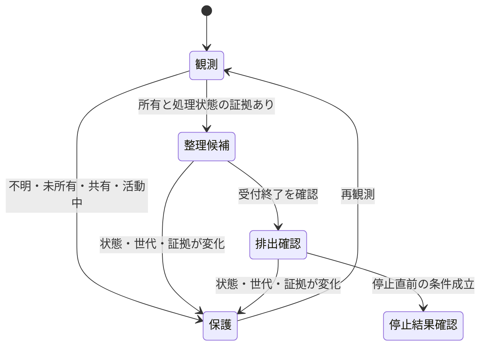

# `ADR-0005`: `PC`全体の観測と、安全な整理の証拠境界

- 日付: 2026年10月29日。
- 状態: 設計案の選定済み。全体観測・新しい表示・新しい停止機能は未実装。
- 関連: [`ADR-0002`](ADR-0002-process-ownership-and-migration-gates.md)、[`ADR-0003`](ADR-0003-bounded-connection-lifecycle.md)、[`ADR-0004`](ADR-0004-stdio-owner-evidence-gate.md)。既存の所有・接続終了条件は維持する。

## 目的と今回の境界

目的は`PC`全体の負荷を下げ、開発を滑らかにすること。`Discord`、`Orca`、進行中の作業も観測する。観測対象に含めることから停止許可を導かない。プロセス名、低`CPU`、古さ、多い本数、親の消滅だけでは不要性を証明できない。

今回の成果は、取得・表示・整理の契約、状態モデル、最小の重複読取り削除。稼働中の製品接続の変更、自動停止対象の追加、フック配置、常駐追加は行わない。既存利用元が残る機能を、不要と推測して削除しない。

## 現状の仕組みと判断の根拠

`inventory.py` は全プロセスの軽いメタデータを列挙するが、保存・表示は指定した所有元の子孫に絞る。親子関係、`PID`世代、チャット対応を検査し、共有・関連・不明を区別する。`resident.py` は観測結果と保護判定・次回間隔を返す。`main.swift` は単発収集の起動と表示を担う。`guarded_stdio.py` と `rpc_activity.py` は起動から所有する接続の活動と終了を扱う。観測画面に停止権限はない。

既存`ADR`は、利用元の責務、所有付き終了、未知の保護、段階移行を明記している。これは直接の根拠である。既存の`Python`観測を再利用すると移植・重複を減らせる、という判断は実装構造からの推論であり、性能優位の証明ではない。

現場の全件取得・上位`CPU`計測・集計は非公開の診断記録に残す。瞬間値や件数の増加をリーク認定にしない。公開文書には実チャット`ID`、登録名、個人パス、原ログを含めない。

### 参照した情報源と限界

- ソース管理: 対象コード、限定した履歴・行履歴、上記`ADR`、既存の修復試験。観測と所有の分離を維持する根拠。
- 課題: [`macOS`の`Node` `REPL`残留報告](https://github.com/openai/codex/issues/39816)。利用者の再現報告であり、現環境と同一原因という証明ではない。
- 修復事例: [`stdio` `MCP`の終了処理を修復した上流`PR`](https://github.com/openai/codex/pull/19753)。過去の修復が現行`Desktop`へ適用されているかは別確認。
- 公式仕様: [`Electron`の画面と描画`PID`の対応](https://www.electronjs.org/docs/latest/api/web-contents#contentsgetosprocessid)、[`CPU`の測定区間](https://www.electronjs.org/docs/latest/api/structures/cpu-usage)。製品内部`API`であり、外部の監視アプリから利用できるとは限らない。
- 既存監視: [`Stats`の実装と負荷の説明](https://github.com/exelban/stats)。汎用監視の先例として参照し、追加導入や丸ごとの複製はしない。
- 実行時・例外の証拠: 既存の非公開診断記録。`CPU`高騰の具体的なコード箇所、実画面との完全な対応は未特定。
- 外部の組織文書・チームチャット・分析基盤: 接続候補はあるが、本件の正本として指定されていないため検索していない。軽量化と現在の依頼範囲を優先し、ローカル証拠・公開一次資料へ限定した。全分類を検索済みとは扱わない。

## 比較と統合判断

`Terra` 6.1の独立した2担当が構造の違う案を作り、別担当が審査した。同じモデル系列であり、異なるモデル系列による一致とは扱わない。

| 基準・各3点 | `A`: `Python`再利用 | `B`: `Swift`収集へ移行 |
| --- | ---: | ---: |
| 保護と停止権限の境界 | 3 | 3 |
| 監視コストの検証可能性 | 2 | 3 |
| 正本再利用と重複削減 | 3 | 1 |
| 全体観測と帰属の正確さ | 3 | 2 |
| 移行リスクの低さ | 3 | 2 |

文書に基づく独立審査と主担当の判断から`A`を土台にする。`B`から、表示中だけの期限付き詳細更新と、旧新の交互測定・欠落率・ウェイクアップを含む比較手順を取り込む。仮の`CPU`・メモリ予算は両案で定義が異なるため比較得点の性能実績にはしない。

`Swift`収集への移行は、同条件の実測で既存経路の起動コストが支配的と確認され、秘匿・権限・世代・帰属の契約を再利用できる場合に再検討する。現時点では二重の収集実装を常駐させない。

## 利用方法とデータのスケッチ

以下は未実装の契約案。既存の`resident snapshot --owner`と出力契約を変更しない。全体観測は明示的な新しい入口と別の保存先へ切り出し、既存キャッシュを自動変換しない。

```text
resident observe --scope system --state PRIVATE_STATE --json
  -> 全体メタデータを1回取得
  -> 世代・親子・限定された対応証拠を結合
  -> 部分値と鮮度を明示した表示データ

inventory selected --keys PRIVATE_SELECTION --json
  -> 指定世代だけを再測定
  -> 全体合計や未測定対象は更新しない
```

```python
@dataclass(frozen=True)
class ProcessKey:
    host_session: str
    pid: int
    started_at: float

@dataclass(frozen=True)
class Coverage:
    scope: str                    # system / selected
    observed: int
    inaccessible: int
    truncated: int
    sampled_monotonic: float

@dataclass(frozen=True)
class BindingEvidence:
    process: ProcessKey
    chat_ref: str                 # 非公開の参照
    relation: str                 # direct / descendant / related
    source: str
    observed_at: float
    expires_at: float

def observe_system(previous, bindings) -> Observation:
    raise NotImplementedError

def observe_selected(keys, previous) -> Observation:
    raise NotImplementedError

def derive_view(observation, previous) -> View:
    raise NotImplementedError
```

`host_session` は個人名を含まない端末ローカルの識別子と`OS`起動時刻から構成する案。取得できない場合は継続性不明として前回の`CPU`差分を使わない。`PID`単体や表示名はキーにしない。読取前後の世代照合に失敗した行は不明にする。

### 対応と集計の規則

1. `OS`の親子関係とチャット対応を別の辺にする。親子の同時刻取得は原子的な証明ではない。
2. チャットとプロセスは多対多。兄弟の帰属を推定せず、共有トランスポートは関連表示だけにする。
3. 正規の実行結合や既存マーカー・`FD`の明示登録を直接証拠に使う。登録名だけでは対応を確定しない。特殊な`FD`確認を全件で回さない。
4. `Electron`の`PID`対応は製品が正式に公開した診断経路がある場合だけ採用する。ソース書換え・注入・無断のデバッグ接続を前提にしない。
5. 全体合計は世代ごとに1回だけ足す。共有値をチャットごとに割り振らない。子孫合計を再加算しない。
6. `RSS`は算術和。共有・圧縮・スワップを含む実消費量の代用にしない。権限欠落時は部分和と欠落件数を表示する。
7. `CPU`は同一世代の累積`CPU`差分を、その対象の単調時計の経過時間で割る。初回・カウンタ逆行・時計不整合は未測定にする。
8. 詳細更新ではその対象の値だけ新しくする。全体の値には全体取得時刻を残す。1行の欠落を、取得できた他行の値まで消す理由にしない。
9. 本数と世代の増減は、同じ観測範囲・欠落条件の連続する全体標本で比較する。増加をリーク・不要性の認定にしない。

## 整理の条件と責務

| 対象 | 観測・表示 | 自動整理 | 人間の操作経路 |
| --- | --- | --- | --- |
| 起動時から既存`guard`が所有する専用接続 | 対応証拠を表示 | 既存の接続終了条件のみ | 既存の所有者が処理 |
| `Discord`・`Orca`・進行中・常時接続 | 全体観測に含める | 保護する | 必要なら対象・保存・影響・世代を確認し正規の終了操作 |
| 共有・対応不明・活動不明 | 不明を表示 | 保護する | 根拠不足のまま停止しない |
| `OS`や別アプリが管理するサービス | 取得範囲内で観測 | 所有を後付けしない | 既存管理元の操作を使う |

既存`guard`が停止を要求できる条件は、起動時からの所有と世代が有効、明示保護なし、接続の受付終了、要求追跡が既知、未応答・部分入力・出力転送がゼロ、停止直前の再確認と猶予条件の成立。観測画面は停止トークンを発行しない。終了要求後は消滅・残留・不明を別に記録し、不明なまま強制停止へ進まない。

活動が変わった、`PID`が再利用された、証拠が期限切れになった場合は整理候補を破棄して保護へ戻す。接続終了後にも自律的に出力するサーバー等は、既存プロトコルで安全性を証明できないため自動整理の採用対象外とする。



### 状態モデルの検査

既存の`pstack` `statechart`で[モデル](../models/process-cleanup/CleanupDesign.tla)を検査した。安全案は70状態・2178遷移で、未追跡・未所有・処理中・保護対象の停止、受付未終了、`PID`世代不一致を禁じる6規則とデッドロック検査が成立した。

「非活動なら保護状態からでも停止できる」という意図的に危険な比較案では86状態・2210遷移。最短の反例はいずれも2遷移だった。

| 違反 | 最短経路 |
| --- | --- |
| 保護対象の停止 | 観測 → 証拠変化で保護 → 停止要求 |
| 未追跡の停止 | 観測 → 未追跡として保護 → 停止要求 |
| 未所有の停止 | 観測 → 未所有として保護 → 停止要求 |
| 受付終了なしの停止 | 観測 → 保護 → 停止要求 |
| `PID`世代未確認の停止 | 観測 → 保護 → 停止要求 |

これは設計上の比較で、現行コードにこの危険経路があるという主張ではない。出力・部分入力・未応答を`busy`へ抽象化し、`OS`の競合、`FD`の寿命、未来のサーバー出力、プロセス消滅の確認はモデル化していない。実装時には実際の状態からこの抽象状態への対応と回帰試験が必要。

再生成は`pstack`の既存`statechart`入口へ、モデル・`safe.cfg`または`unsafe.cfg`・`view.mjs`と新しい出力先を渡す。危険案の非ゼロ終了は期待結果。実機の停止は実行しない。

## 監視自体を軽くする設計

- 閉じている間の全体観測は既存の通常120秒、圧迫・部分・失敗・遅い収集時300秒を初期値とする。
- 詳細を開いた時だけ、明示選択した最大32世代を15秒間隔で再取得する案。5分で期限切れにする。これらは実測前の設計値であり、性能保証ではない。2〜5秒更新は負荷の比較に合格するまで採用しない。
- 全体・詳細を合わせて収集中は1件だけ。詳細更新で全体列挙、タイトル`DB`読取り、`FD`走査を繰り返さない。選択外の増減は次の全体観測まで未確定。
- 圧迫・遅延・失敗時は詳細更新を止める。睡眠中は休止し、復帰時は世代と`CPU`基準を取り直す。失敗で新しい収集を重ねない。
- 既存メニューバーを入口とし、全件表示が必要ならネイティブの表を使う案。表示対象と観測対象を区別し、一覧を省略した場合は省略件数を示す。新しい`Web`サーバーは設けない。
- 通常保存は秘匿済み最新標本1件。現在と直前標本はメモリ内に保持し、増減履歴は種類別集計を最大6標本だけ保持する案。全件の無制限履歴、本文、引数、環境、原ログは保存しない。
- 初期の受入目標は、`UI`・収集子・補助子を含む平均`CPU`が単一コア換算1%以下、監視全体`RSS`のピーク合計100`MiB`以下。仮目標として測定し、超える場合は詳細更新を無効にして頻度を下げる。既存値より悪化したまま採用しない。

旧新を同条件で交互に測り、累積`CPU`秒、壁時間、起動回数、`RSS`、ウェイクアップ、欠落率を記録する。待機区間と収集区間を分離する。ユーザー操作の改善は、送信から発言表示までの待ち時間と反復失敗で判定し、プロセス数減少だけでは成功にしない。

## リファクタ・移行・仕組み化

1. 今回、`resident`のロック外の事前キャッシュ読取りを削除し、`inventory.snapshot`の既存ロック内へ未来時刻検査を集約した。読取り2回の再現試験は修復前に失敗、修復後の関連80件が成功。純粋な変更範囲であり、停止権限を追加しない。実機配布・`CI`とは別のローカル結果。
2. 次の実装単位は、全件観測の明示入口とカバレッジ、世代・多対多対応・部分集計の契約。既存`v1`利用元を列挙して互換試験後に導入する。
3. その次に、全件表・期限付き選択更新・6標本の増減を実装し、監視コストを実測する。チャットや描画の対応が取れない部分は不明のまま表示する。
4. 自動整理を広げる前に、対象1接続で起動から所有し、要求中保持・受付終了・排出・消滅を実証する。既存の`Discord`・`Orca`接続は勝手に移行しない。
5. 削除は利用元・参照・実行経路がゼロと確認できた重複だけ。`Python`全体や`CLI`、所有台帳、秘匿、既存終了管理を先に撤去しない。状態ファイルや`DB`の一括削除はしない。

再利用するハーネスは既存`pytest`、表示`fixture`、`pstack` `statechart`、契約・公開前検査。運用の入口は既存 `codex-runtime-feedback-loop` と `task-mechanize`。今回は新しいスキル・専用常駐エージェント・フックを増やさない。新規プロセスの実行結合が必要な時だけ、既存フック観測を読取り用途で再利用する設計を別途確定する。フックイベントから既存`PID`の所有を作らない。

小ループは再現→最小変更→試験、大きなループは経路別診断→アプリ操作→配送→再発確認とし、[既存`PDCA`](../RUNTIME_PDCA.md)へ接続する。外部回答待ち、実画面との対応、全体機能の実装・実機受入、`Mac`全体試験の既存失敗が残る間は、本体の重さ解消や残務ゼロとは扱わない。
